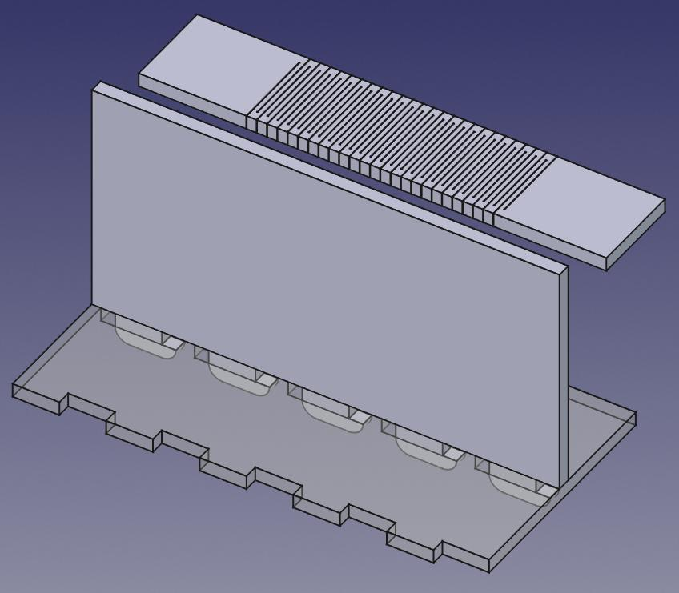

# LaserBoxTools

A FreeCAD workbench for designing laser-cut boxes and enclosures. Create parametric tabs, slots, and living hinges on your 3D models for easy laser cutting and assembly.




**Video tutorial:** [How to use basic features](https://youtu.be/m_Drmns1SJE)

## Features

- **Make Box** — Create rectangular box pieces with configurable dimensions and optional tabs/slots. These are a collection of separate parts or separate bodies which are grouped together to make a box.
- **Tabs** — Add parametric finger tabs along the length of faces for joining panels. Supports tab count, width, depth, taper, margins, and optional hook profiles
- **Slots** — Generate slots along the length of faces to receive tabs from other panels. Configurable slot count, length, depth, and gap width
- **Living Hinge** — Create flexible hinge patterns (e.g. straight elements) along faces for flexible designs
- **Kerf compensation** — Tabs, Slots and Make Box have a **Kerf** parameter (the laser beam width). Tabs are widened and slots narrowed by kerf/2 on each side (centres unchanged, ends on the panel edge are left in place) so joints fit snugly after cutting. Default is 0 (no compensation).

All features work on selected faces and edges of your Part or PartDesign bodies, with optional auto-update when parameters change.

## Requirements

- [FreeCAD](https://www.freecad.org/) (tested with FreeCAD 1.x)
- PySide (included with FreeCAD)

## Installation

### Option 1: Addon Manager (recommended)

1. Open FreeCAD
2. Go to **Tools → Addon Manager**
3. Search for "LaserBoxTools"
4. Click **Install**

> If this workbench is not yet in the Addon Manager repository, use manual installation below.

### Option 2: Manual installation

From Github directly:
1. Open preferences and navigate to "Addon Manager" -> "Addon Manager Options"
2. Under Custom Repositories, click + and enter:
   Repository URL: https://github.com/Eskibrew/LaserBoxTools
   Branch: main
3. Under "Tools" "Addon Manager" you should now be able to find and install LaserBoxTools.
4. Restart FreeCAD
5. Select the **Laser Box Tools** workbench from the workbench dropdown

From Github download:
1. Clone or download the Github repository
2. Copy the entire `LaserBoxTools` folder into your FreeCAD Mod directory:
   - **Linux**: `~/.local/share/FreeCAD/Mod/` (or `~/.local/share/FreeCAD/v1-2/Mod/` for FreeCAD 1.2)
   - **Windows**: `%APPDATA%\FreeCAD\Mod\`
   - **macOS**: `~/Library/Application Support/FreeCAD/Mod/`
3. Note, if downloading the ZIP file, you'll need to rename the extracted directory "LaserBoxTools"
3. Restart FreeCAD
4. Select the **Laser Box Tools** workbench from the workbench dropdown

## Usage

1. Create a new file or open a Part or PartDesign model
2. Switch to the **Laser Box Tools** workbench
3. Create a new box using:
   - **LBMakeBox** — Create a new box or;
4. Select a face on your model and use one of the tools:
   - **LBTabs** — Add tabs to the selected face
   - **LBSlots** — Add slots to the selected face
   - **LBLivingHinge** — Add a living hinge along the selected face

Adjust parameters in the property panel or task panel. Enable **Auto Update** to refresh the geometry when you change values.

## Project Structure

```
LaserBoxTools/
├── freecad
│   ├── laserboxtools
│   │   ├── commands
│   │   │   ├── __init__.py
│   │   │   ├── add_slots_command.py
│   │   │   ├── add_tabs_command.py
│   │   │   ├── laser_box_tools_manipulator.py
│   │   │   ├── living_hinge_command.py
│   │   │   └── make_box_command.py
│   │   ├── features
│   │   │   ├── __init__.py
│   │   │   ├── add_slots_feature_object.py
│   │   │   ├── add_slots_feature_vp.py
│   │   │   ├── add_tabs_feature_object.py
│   │   │   ├── add_tabs_feature_vp.py
│   │   │   ├── living_hinge_feature_object.py
│   │   │   ├── living_hinge_feature_vp.py
│   │   │   ├── make_box_feature_object.py
│   │   │   └── make_box_feature_vp.py
│   │   ├── gui
│   │   │   ├── add_slots_task_panels.py
│   │   │   ├── add_tabs_task_panels.py
│   │   │   ├── living_hinge_task_panels.py
│   │   │   ├── add_clots_task_panels.py
│   │   │   └── make_box_task_panels.py
│   │   ├── resources
│   │   │   ├── docs
│   │   │   │   ├── Overview.md
│   │   │   │   └── Screenshot.jpg
│   │   │   ├── icons
│   │   │   │   ├── box.svg
│   │   │   │   ├── LBLogo-wb.svg
│   │   │   │   ├── LBLogo.svg
│   │   │   │   ├── livinghinge.svg
│   │   │   │   ├── slots.svg
│   │   │   │   └── tabs.svg
│   │   │   ├── translations
│   │   │   │   ├── laserboxtools_es-ES.ts
│   │   │   │   ├── README.md
│   │   │   │   └── update_translation.py
│   │   │   └── ui
│   │   │       ├── hinge.ui
│   │   │       ├── makebox.ui
│   │   │       ├── slots.ui
│   │   │       ├── tabs.ui
│   │   │       └── __init__.py.py
│   │   ├── src
│   │   │   ├── create_slots.py
│   │   │   ├── create_tabs.py
│   │   │   ├── laser_helper.py
│   │   │   └── make_box.py
│   │   ├── __init__.py
│   │   ├── init_gui.py
│   │   ├── laser_box_tools_workbench.py
│   │   └── version.py
│   ├── src
│   │   ├── laserlivinghinge.py
│   │   ├── laserslots.py
│   │   └── lasertabs.py
├── LICENSE-Assets
├── LICENSE-Code
├── package.xml
├── pixi.toml
├── pyproject.toml
└── README.md
```

## License

This project is licensed under the **GNU Lesser General Public License v2.1** (LGPL-2.1). See the [LICENSE](LICENSE) file for details.

## Credits

- Copyright (c) 2022 EskiBrew
- migrated to the modern addon structure 2026 EskiBrew